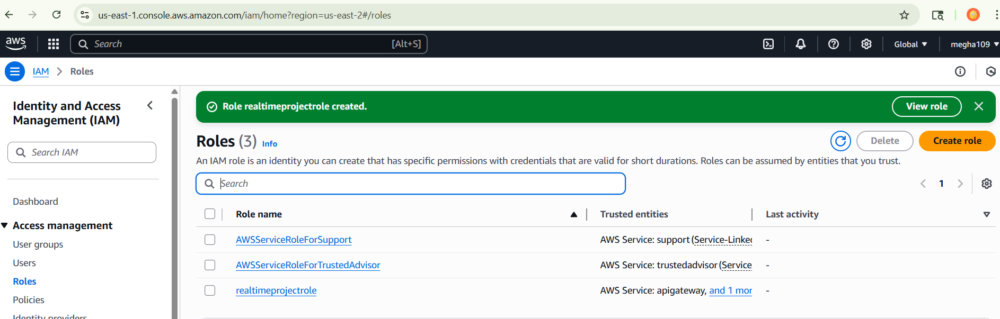
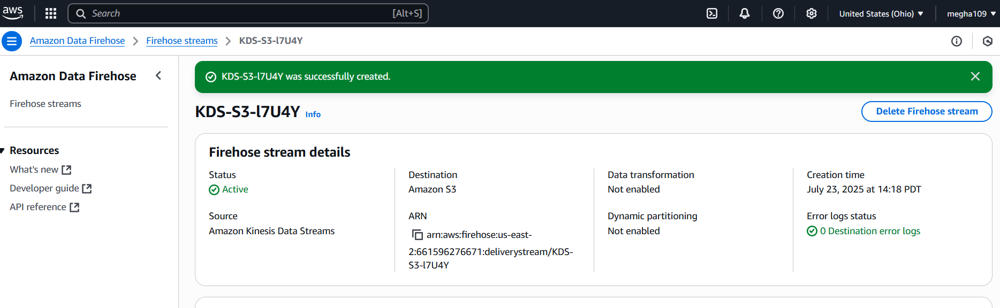

Step1 :

Step 2 : s3 bucket for 
1.data - realtimeproject-databucket2307

and 2.error or reject -realstreamproject-errorbucket2307

Step 3 : create kinesis stream
 realtimeprojectstream2307 

step 4: create kinesis hirhose

KDS-S3-l7U4Y

step5 : lambda - realtimeproject-lambda

Step 6: API gateway
relatimeprojectAPI - RESTAPI

